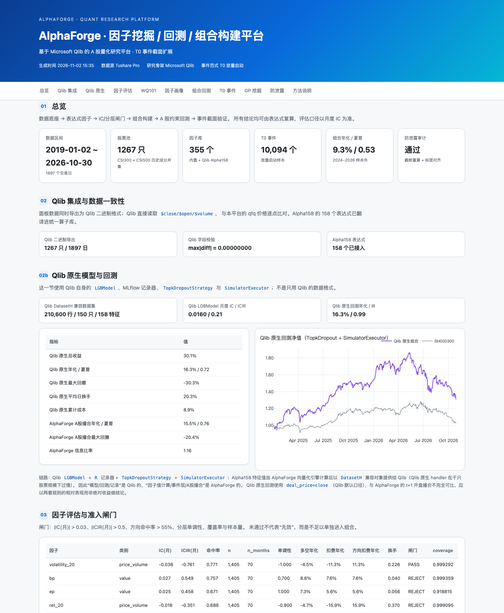
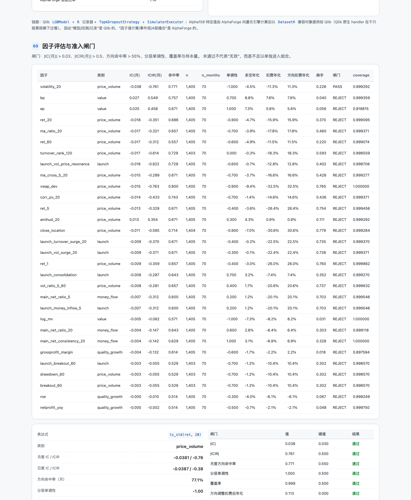
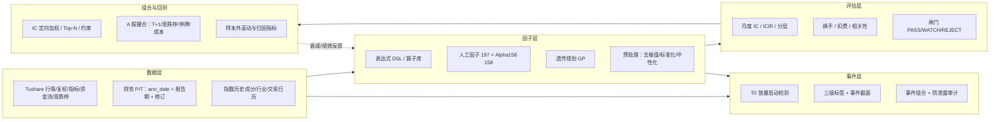
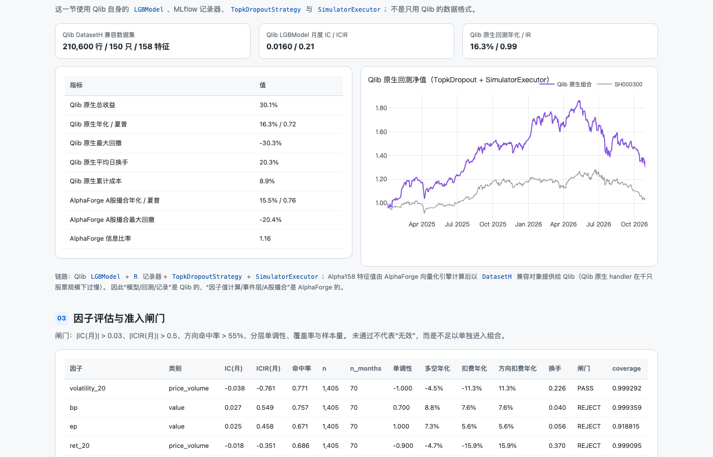
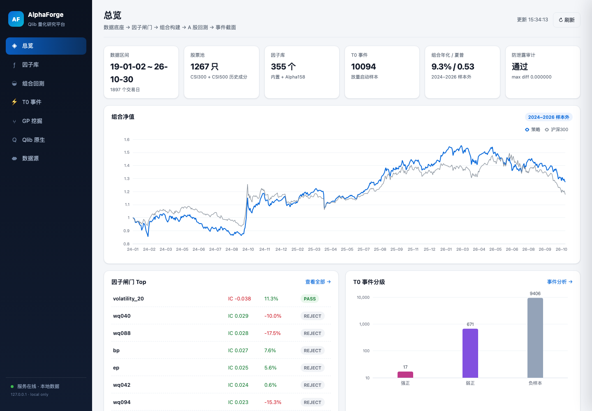
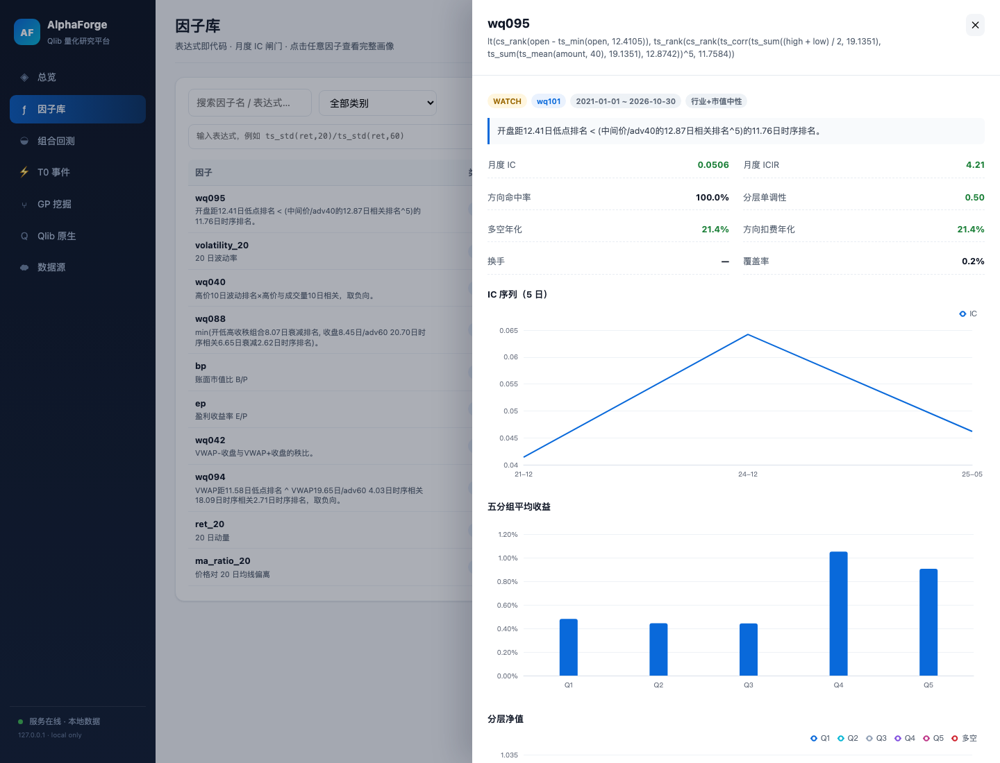
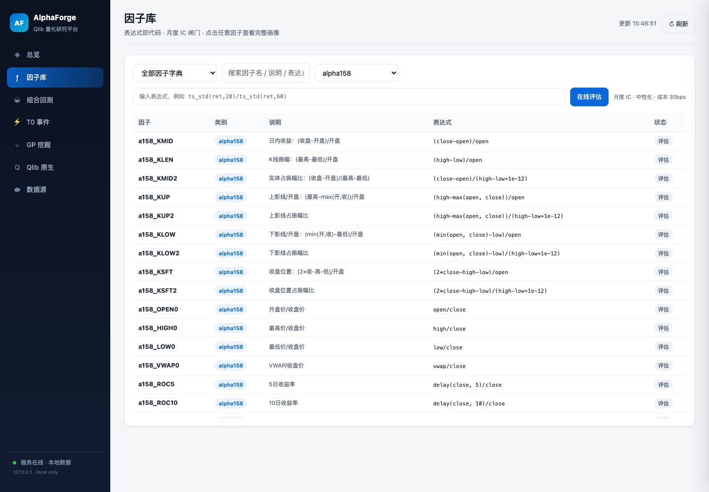

# AlphaForge · 基于 Qlib 的因子挖掘 / 回测 / 组合构建平台

> 把《Alpha 策略与因子挖掘平台》调研报告落成可运行的平台：**PIT 数据底座 → 表达式因子引擎 → IC/分层闸门 → 组合构建 → A 股约束回测 → T0 事件截面验证**。
> 研究骨架使用 Microsoft Qlib（数据格式 + Alpha158 + 模型生态），事件截面与 A 股撮合规则自研。




---

## 1. 能力总览

| 能力 | 实现 | 关键文件 |
|---|---|---|
| 数据底座 | Tushare 日线/复权/每日指标/资金流/涨跌停价/财务 PIT，SQLite 落库 | `src/alphaforge/data/ingest.py` |
| 面板计算 | `T×N` float32 稠密面板 + 可交易性/涨跌停/停牌掩码 | `src/alphaforge/data/panel.py` |
| Qlib 集成 | 导出 Qlib 二进制格式；`D.features` 逐点校验；Alpha158 全部 158 个表达式接入 | `src/alphaforge/data/qlib_export.py` |
| 表达式引擎 | 自研 DSL：算术/比较/时序/截面/条件算子，NaN 感知、因果滚动 | `src/alphaforge/expr/` |
| 因子库 | 197 个内置因子（价量/资金/估值/质量/启动族 + **WorldQuant 101**）+ 158 个 Alpha158 | `src/alphaforge/expr/library.py` |
| 评估闸门 | 月度 IC / ICIR / 方向命中率 / 分层单调性 / 扣费后方向收益 / 覆盖率 / 样本量 | `src/alphaforge/evaluate/core.py` |
| 预处理 | MAD 去极值 → 截面 Z-score → 行业 + 市值中性化（FWL） | `src/alphaforge/preprocess.py` |
| 组合构建 | IC 定向加权、Top-N、排名缓冲、单票/行业上限、行业+市值中性 | `src/alphaforge/portfolio/combine.py` |
| 回测 | T+1、涨跌停不可成交、停牌、100 股整手、佣金/印花税/滑点/成交额占比、次开盘撮合 | `src/alphaforge/backtest/engine.py` |
| 因子挖掘 | 遗传规划：表达式树、RankIC 适应度、风格快速中性化、复杂度惩罚、Train/Valid/Test 衰减 | `src/alphaforge/mining/gp.py` |
| T0 事件 | 放量启动检测、三级标签、事件截面 IC、事件组合回测、防泄露审计 | `src/alphaforge/event/` |
| 报告 | 离线自包含 HTML 研究看板（Plotly） | `src/alphaforge/report/` |
| Web 控制台 | 交互式前端：总览 / 因子库 / 在线评估 / 回测 / 事件 / GP / Qlib / 数据源 | `src/alphaforge/web/` |
| 多数据源 | Tushare / iFinD / DataYes 探活、预览与可选落库 | `src/alphaforge/data/sources.py` |

**实测口径**（本机 2019-01-02 ~ 2026-10-30，CSI300+CSI500 历史成分并集 1,267 只、1,897 个交易日）：

- Qlib 二进制导出 1,267 只 / 1,897 日；`$close/$open/$volume` 与面板逐点比对 **max|diff| = 0.0**；
- 30 个内置因子完整评估 → 1 个通过闸门（`volatility_20`，月度 |IC| 0.038、|ICIR| 0.76、
  方向调整扣费后年化 11.3%）；
- 多因子组合 2024–2026 样本外：**年化 9.3%、夏普 0.53、最大回撤 -18.0%、年化换手 11.5×、超额 9.5%**（基准 CSI300）；
- T0 事件 **10,094** 个（强正 17 / 弱正 671 / 负 9,406），事件截面 IC 最高 `volatility_20` = -0.088；
- 防泄露审计：截断重算 **max|diff| = 0.0**，财务 PIT 差异 3.7e-7，标签对齐正常。

> 以上为研究结果，不是实盘收益承诺。完整看板见 [`reports/alphaforge_report.html`](reports/alphaforge_report.html)。

---

## 2. 快速开始

### 2.1 环境

已验证：macOS arm64、Python 3.12、`pyqlib==0.9.7`。Qlib 官方 wheel 对 Python 3.13 支持不完整，建议 3.12。

```bash
cd /Users/crsec_ai_lab/Quant/qlib
python3.12 -m venv .venv
.venv/bin/pip install pyqlib==0.9.7 lightgbm scipy scikit-learn pyarrow matplotlib \
    plotly jinja2 pyyaml tqdm tushare
.venv/bin/pip install -e . --no-deps
```

Qlib 会引入 `pandas/numpy/scipy/lightgbm/mlflow/fastapi` 等依赖；若只做研究，无需额外安装。

### 2.2 Tushare Token

按以下优先级解析：

1. 环境变量 `TUSHARE_TOKEN`；
2. `config/credentials.json` 中的 `{"TUSHARE_TOKEN": "..."}`；
3. `~/Quant/qQuant/quantlab/config/credentials.json`（本机已有则自动复用）。

### 2.3 一条命令跑通

```bash
# 1) 数据摄取（约 15 分钟；断点可续跑）
alphaforge ingest --start 2019-01-01 --end 2026-10-30

# 2) 构建面板 + 导出 Qlib + 校验
alphaforge build --export-qlib --verify

# 3) Qlib 原生：LGBModel + R 记录器 + TopkDropout + SimulatorExecutor
alphaforge qlib native --symbols 150 --topk 50

# 4) 端到端演示（面板 -> 因子 -> 组合 -> 回测 -> 事件 -> GP -> HTML）
alphaforge demo

# 5) 本地 Web 控制台（另开终端；会占用当前进程）
alphaforge web --port 8787
# 浏览器打开 http://127.0.0.1:8787

# 6) 单独跑完整 GP（200 个体 × 15 代）
alphaforge factors mine --population 200 --generations 15
```

输出：

- `reports/alphaforge_report.html`：离线研究看板；
- `reports/artifacts/*.json`：因子排行榜、回测、事件、GP、审计结果；
- `data/qlib_cn/`：Qlib 二进制数据（可直接 `qlib.init(provider_uri=...)`）；
- `data/events/events.parquet`：T0 事件样本库；
- `reports/artifacts/factors/`：因子详情快照（Web 控制台使用）；
- `artifacts/factors/registry.jsonl`：因子注册库（`--register` 时写入）。

### 2.4 Python API

```python
from alphaforge.data.panel import load_panel
from alphaforge.expr import evaluate
from alphaforge.evaluate.core import evaluate_factor

panel = load_panel()                              # 读缓存面板
factor = evaluate("ts_std(ret, 20) / ts_std(ret, 60)", panel)
report = evaluate_factor(panel, "volatility_20", start="2021-01-01")
print(report.verdict, report.ic[5]["mean_monthly"], report.quantile["long_short"])
```

---

## 3. 架构



- **数据层**：SQLite 只存原始量价与 PIT 财务；`PanelStore` 一次性 pivote 成 `T×N` 面板并缓存 `.npz`，DB 修改时间变化即失效。
- **因子层**：所有因子都是字符串表达式，可版本化、可复算；GP 产出与人工因子共用同一算子库和评估流水线。
- **评估层**：闸门是准入门槛而非展示；月度 IC 是主口径，避免日频重叠样本把 ICIR 放大。
- **组合层**：先做因子中性化与 IC 定向，再选股；换手通过排名缓冲与月度调仓控制。
- **事件层**：把“日历截面”改成“事件截面”，特征是 T0−1 截面，标签是 T0 起 60 日路径。

---

## 4. 因子表达式 DSL

“公式即代码”，示例：

```text
close / ts_mean(close, 20) - 1
ts_std(ret, 20) / ts_std(ret, 60)
ts_corr(close, volume, 20)
cs_rank(ts_mean(main_net_ratio, 5))
where(gt(ret, 0), 1, 0) * volume
(close - ts_min(low, 60)) / (ts_max(high, 60) - ts_min(low, 60) + 1e-9)
```

- 算术：`+ - * / ^`，比较：`> < >= <= == !=`；
- 时序：`delay/ts_mean/ts_std/ts_max/ts_min/ts_rank/ts_argmax/ts_corr/ts_cov/ts_quantile/ts_decay_linear/ts_ema/ts_skew/ts_kurt/ts_slope/ts_rsquare/ts_resi/...`；
- 截面：`cs_rank/cs_zscore/cs_demean/cs_scale/cs_winsorize/cs_quantile/cs_corr`；
- 条件：`where/gt/lt/ge/le/and/or/not`。

完整算子表：`alphaforge factors ops`，或见 [`docs/FACTOR_DSL.md`](docs/FACTOR_DSL.md)。

**每个因子都有中文说明**：共 355 个 = 内置 197（其中 WQ101 101）+ Alpha158 158。
`alphaforge factors list --category all` 可列出全部；Web「因子库 → 全部因子字典」
可按类别/关键词检索；离线表格见 [`docs/FACTOR_DICTIONARY.md`](docs/FACTOR_DICTIONARY.md)。

### WorldQuant 101

`101factors.pdf` 的 101 条公式已全部注册为 `wq001`…`wq101`（类别 `wq101`）：

```bash
alphaforge factors list --category wq101
alphaforge factors eval wq001
alphaforge factors batch --category wq101   # 全量评估并写入 Web 因子库
```

转译规则、`indneutralize`/`adv20`/`scale` 的口径与局限见
[`docs/WQ101.md`](docs/WQ101.md)。

---

## 5. 评估闸门（月度口径）

| 检查 | 阈值 | 说明 |
|---|---|---|
| \|IC\| | ≥ 0.03 | 月度 IC 均值绝对值 |
| \|ICIR\| | ≥ 0.50 | 月度 IC 均值 / 标准差 |
| 方向命中率 | ≥ 55% | 取 IC 方向的胜率 |
| 分层单调性 | ≥ 0.5 | 五分组均值与组序的秩相关（取绝对值） |
| 扣费后方向收益 | > 0 | 方向调整后的多空年化，扣除双边成本 |
| 覆盖率 | ≥ 50% | 有效值占股票池比例 |
| 样本期数 | ≥ 24 月 | 避免短样本过拟合 |

结论分 `PASS / WATCH / REJECT`；未通过不等于因子无效，而是不足以单独进入组合。扣费后方向收益为负的高 IC 因子会被直接拒绝——这正是“IC 很高但换手 80%”的典型陷阱。

---

## 6. 组合与回测

- **打分**：因子截面 Z-score → 行业+市值中性化 → 按训练期 IC 定向加权（`ic_weighted`）或等权（`equal`）。
- **选股**：Top-N + 排名缓冲（`buffer`），单票上限、行业内上限，未分配权重留现金。
- **撮合**：信号日 `t` 收盘生成目标，`t+1` 开盘成交；涨跌停/停牌不可成交；T+1；100 股整手；成交额占比上限。
- **成本**：佣金万三双边、印花税万五卖出、滑点万五；报告中同时给出毛收益与扣费收益。
- **回测输出**：净值、回撤、年化/夏普/Calmar、年化换手、超额、信息比率、Beta、月度胜率。

示例：

```bash
alphaforge backtest --start 2024-01-02 --end 2026-10-30 \
  --train-start 2021-01-01 --train-end 2023-12-31 \
  --rebalance 21 --top-n 50
```

---

## 7. T0 事件截面

**事件定义**（可配置）：量比 ≥ 2.5、日涨幅 ≥ 3%、换手率 120 日分位 ≥ 80%、收盘站上 20 日均线、成交额 ≥ 500 万、非停牌、非一字板；同一股票 20 交易日内只保留首次事件。

**标签**：

| 字段 | 定义 |
|---|---|
| `label_ret` | close(T0+60) / close(T0) − 1 |
| `label_max` | max(high(T0+1..T0+60)) / close(T0) − 1 |
| `label_mdd` | min(low(T0+1..T0+60)) / close(T0) − 1 |
| `tier` | strong：`label_max ≥ 200%` 且回撤 < 50%；weak：`≥ 60%`；否则 negative |
| `entry_ret` | close(T0+60) / open(T0+1) − 1（可交易口径） |

**评估**：按 20 交易日聚合事件截面，计算特征与 60 日收益的 RankIC；事件组合按 T0+1 开盘入场、等槽位、固定持有 60 日。

**防泄露审计**：把面板截断到 T0−1 重算特征并与缓存值比对（实测 max|diff| = 0.0），同时校验 `asof_idx < t0_idx`、`entry_idx > t0_idx`、财务 `ann_date <= asof`。

---

## 8. Qlib 集成边界

> 完整映射、源码安装与限制见 [`docs/QLIB_INTEGRATION.md`](docs/QLIB_INTEGRATION.md)。

已落地：

1. **数据格式**：`calendars/day.txt` + `instruments/all.txt` + `features/{SYMBOL}/{field}.day.bin`，Qlib `D.features` 可直接读取；
2. **一致性校验**：`alphaforge qlib verify` 对 `$close/$open/$volume` 逐点比对；
3. **Alpha158**：从 `Alpha158DL.get_feature_config()` 读取 158 个表达式，自动翻译为 AlphaForge DSL（`Ref→delay`、`Mean→ts_mean`、`Greater→max` 等），在统一算子库中计算；
4. **Qlib 原生训练/回测**：`alphaforge qlib native` 使用 Qlib 自己的
   `LGBModel` + `qlib.workflow.R`（MLflow 记录器）+ `TopkDropoutStrategy`
   + `qlib.backtest` / `SimulatorExecutor`，不是只用 Qlib 的数据格式；
5. **Qlib 预测回流**：把 Qlib `pred` 转成面板得分，再用 AlphaForge 的 A 股约束回测复核，
   同一组预测可以对比“Qlib 原生撮合”和“T+1/涨跌停/成本”两套规则。



**混合的原因**：Qlib 自带的 `Alpha158` handler 在 1,267 只 × 1,900 日规模下逐股计算
过慢（实测 100 只 × 3 年 >10 分钟未完成）。因此采用：
**Alpha158 表达式（Qlib 定义）→ AlphaForge 向量化引擎算值 → 以 DatasetH 兼容对象喂给 Qlib
的 LGBModel/TopkDropout/backtest**。模型、记录器、策略、执行器都是 Qlib 的代码；因子值计算、
事件层与 A 股撮合是 AlphaForge 的。

本机 150 只样本的实测（2025-01 ~ 2026-10 样本外）：

| 项 | 结果 |
|---|---|
| Qlib DatasetH 兼容数据集 | 210,600 行 / 150 只 / 158 特征 |
| Qlib LGBModel 月度 IC / ICIR | 0.0160 / 0.21 |
| Qlib 原生回测（TopkDropout + SimulatorExecutor） | 年化 16.3%、IR 0.99、最大回撤 -30.3%、平均日换手 20.3% |
| 同一预测 -> AlphaForge A 股撮合 | 年化 15.5%、夏普 0.76、最大回撤 -20.4%、IR 1.16 |

> 样本只有 150 只、月度 IC 仅 0.016，说明这个 LGBM/Alpha158 组合在本股票池上并没有强 alpha；
> 平台保留这个“不理想但真实”的结果，而不是只展示训练集指标。Qlib 原生回测的 `deal_price=close`
> 与 AlphaForge 的 t+1 开盘撮合口径不同，两者收益不可直接比较。

---

## 9. Web 控制台

```bash
alphaforge web --port 8787
# http://127.0.0.1:8787
```

- **总览**：数据区间、股票池、组合净值、因子闸门 Top、T0 分级；
- **因子库**：搜索/分类、点击查看 IC/分层/闸门/表达式；「全部因子字典」可查看 355 个因子的中文说明，支持在线输入表达式评估；
- **组合回测**：净值/基准、回撤、月度收益；
- **T0 事件**：三级标签、事件截面 IC、事件组合净值、防泄露审计；
- **GP 挖掘**：进化曲线、Train/Valid/Test 候选表；
- **Qlib 原生**：二进制一致性、LGBModel 指标、Qlib 回测与 A 股撮合对照；
- **数据源**：Tushare / iFinD / DataYes 配置状态、一键探活、数据湖行数。





前端为本地静态文件 + ECharts（离线可用），只读本地 `reports/artifacts` 与 `market.db`，不上传数据。
接口与扩展方式见 [`docs/WEB_CONSOLE.md`](docs/WEB_CONSOLE.md)。

## 10. 目录结构

```text
alphaforge/
├── configs/default.yaml          # 数据/评估/回测/事件/GP 参数
├── src/alphaforge/
│   ├── data/                     # ingest / schema / panel / qlib_export
│   ├── expr/                     # ast / parser / ops / engine / library / wq101
│   ├── evaluate/core.py          # IC / 分层 / 换手 / 闸门 / 相关性
│   ├── preprocess.py             # 去极值 / 标准化 / 中性化
│   ├── portfolio/combine.py      # 因子合成 / 选股 / 目标权重
│   ├── backtest/engine.py        # A 股约束回测
│   ├── mining/                   # GP / 因子注册库
│   ├── event/                    # 检测 / 标签 / 数据集 / 评估 / 审计
│   ├── qlib_native.py            # Qlib LGBModel/TopkDropout/backtest 原生链路
│   ├── report/                   # HTML 报告
│   ├── pipeline/demo.py          # 端到端流水线
│   └── cli.py                    # alphaforge 命令
├── src/alphaforge/web/           # FastAPI + 原生 JS + ECharts 控制台
├── tests/test_core.py            # 13 个核心单测
├── docs/                         # 架构 / 方法 / 运维 / 路线 / DSL
├── data/                         # market.db, qlib_cn, cache, events
├── artifacts/factors/            # 因子注册库 / GP 运行记录
└── reports/                      # HTML 看板与 JSON 结果
```

---

## 11. 数据源：Tushare / iFinD / DataYes

平台以 Tushare 为默认主库，同时支持你已有的同花顺 iFinD 与通联 DataYes：

```bash
alphaforge sources status --probe
alphaforge sources probe --source ifind
alphaforge sources fetch --source datayes --codes 000001,600000 --start 2024-01-01 --end 2024-01-31
alphaforge sources fetch --source ifind  --codes 000001 --start 2024-01-01 --end 2024-01-31 --adjust qfq
# 确认字段/单位后写入 market.db（可选）
alphaforge sources fetch --source datayes --codes ... --write
```

- 凭据优先级：环境变量 → `config/credentials.json` → `~/Quant/qQuant/quantlab/config/credentials.json`；
- DataYes 返回 `accumAdjFactor`，可直接落 `adj_factor`；iFinD 支持 `none/qfq/hfq`；
- 默认只读预览，`--write` 才写库，避免不同厂商数据混入口径；
- 详见 [`docs/DATA_SOURCES.md`](docs/DATA_SOURCES.md)。

## 12. 与调研报告的对应关系

| 报告章节 | 平台实现 |
|---|---|
| 第 4 章 五层架构 | `data/expr/evaluate/portfolio/backtest` 分层 + `pipeline/demo.py` 串联 |
| 第 5 章 因子体系 | 197 个内置因子（价量/资金/情绪/基本面/环境 + WorldQuant 101）+ Alpha158 |
| 第 6 章 挖掘平台 | 人工因子 + GP（RankIC 适应度、复杂度惩罚、相关性去重）；RL 接口预留 |
| 第 7 章 评估体系 | 月度 IC/ICIR/分层/换手/成本压力测试 + 闸门 |
| 第 8 章 T0 定制 | 事件检测、三级标签、事件截面 IC、可交易掩码、防泄露审计 |
| 第 9 章 四阶段 | 数据底座、因子引擎、挖掘闭环、组合回测均已可运行；模拟盘/实盘为后续 |
| 第 10 章 风险对策 | PIT、A 股撮合约束、样本外、成本、审计 |

---

## 13. 已知局限

- 行业分类使用 Tushare 当前快照，存在轻微前视；历史行业成分需接入申万/中信分类后替换。
- 股票池构建剔除**当前名称**含 ST/退 的标的，存在轻微幸存者偏差；面板内另有日频 ST 代理（主板 5% 涨跌停区间）用于交易掩码，历史 ST 变更链尚未接入。
- 数据末端（最后 60 个交易日）的 T0 事件 60 日标签不完整，事件 IC 解读需剔除或降权。
- 财务 PIT 以 `fina_indicator` 的 `ann_date` 为准；同一公告日多版本只保留最后一条。
- 未含盘中数据、融券约束、分红再投资、指数期货对冲；事件组合为等槽位简化撮合。
- 月度 IC 的 t 值在重叠样本下会高估，报告同时给出日频与月度口径，解读需谨慎。
- 演示结果依赖本机 Tushare 数据快照与 token 权限，换环境后数值不可直接复现。

## 14. 交付物清单

| 交付物 | 路径 |
|---|---|
| 研究看板（离线 HTML） | [`reports/alphaforge_report.html`](reports/alphaforge_report.html) |
| 平台代码 | `src/alphaforge/`（数据/表达式/评估/组合/回测/挖掘/事件/报告/CLI） |
| 因子注册库 | `artifacts/factors/registry.jsonl`（`factors mine --register` 写入） |
| GP 运行记录 | `artifacts/factors/gp_latest.json` |
| 演示结果 | `reports/artifacts/*.json` |
| Qlib 数据 | `data/qlib_cn/` |
| T0 事件样本库 | `data/events/events.parquet` |
| Web 控制台 | `src/alphaforge/web/`（`alphaforge web --port 8787`） |
| 文档 | [`docs/ARCHITECTURE.md`](docs/ARCHITECTURE.md)、[`docs/METHODOLOGY.md`](docs/METHODOLOGY.md)、[`docs/OPERATIONS.md`](docs/OPERATIONS.md)、[`docs/FACTOR_DSL.md`](docs/FACTOR_DSL.md)、[`docs/ROADMAP.md`](docs/ROADMAP.md)、[`docs/QLIB_INTEGRATION.md`](docs/QLIB_INTEGRATION.md)、[`docs/WEB_CONSOLE.md`](docs/WEB_CONSOLE.md)、[`docs/DATA_SOURCES.md`](docs/DATA_SOURCES.md)、[`docs/WQ101.md`](docs/WQ101.md)、[`docs/FACTOR_DICTIONARY.md`](docs/FACTOR_DICTIONARY.md)、[`docs/PORTFOLIO_BACKTEST.md`](docs/PORTFOLIO_BACKTEST.md) |

## 15. 免责声明

本项目仅用于量化研究与工程实践，不构成任何投资建议或收益承诺。历史回测不代表未来表现。
